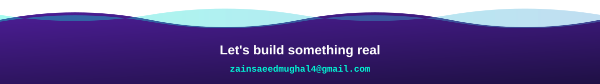

<div align="center">
  
  <br/><br/>
  <a href="https://www.linkedin.com/in/zain-saeed-mughal"></a>
  <a href="mailto:zainsaeedmughal4@gmail.com"></a>
  <a href="https://goconnectivo.com"></a>
</div>

<br/>

<h2>👋 Hey, I'm Zain</h2>

<p>
Final year BSCS student at <b>Iqra University, Islamabad</b> and <b>Full Stack Developer at Balitech</b>.
I own products end to end: requirements, UI, frontend, backend, database, and the production server it all runs on.
</p>

<ul>
  <li>🚀 <b>6+ live products</b> shipped at Balitech</li>
  <li>🔐 Built a <b>4 role approval system</b> with realtime push notifications</li>
  <li>🖥️ Deploy and manage my own apps on <b>production servers and VMs</b></li>
  <li>🎨 Ex graphic designer, so the UI actually looks good</li>
  <li>💬 Ask me about <b>Flutter architecture</b>, <b>Next.js</b> or shipping fast</li>
</ul>

```dart
class Zain extends Developer {
  final city = "Islamabad";
  final role = "Full Stack Developer @ Balitech";
  final shipped = 6;
  final mobile = ["Flutter", "Dart", "BLoC", "Provider", "Firebase"];
  final web = ["Next.js", "React", "Node.js", "Express", "TypeScript"];
  final data = ["MongoDB", "Supabase", "Firebase"];

  String get motto => "Design it. Build it. Ship it.";
}
```

<h2>🛠️ Tech Arsenal</h2>

<div align="center">
  <p><b>📱 Mobile</b></p>
  
  <p><b>🌐 Web and Backend</b></p>
  
  <p><b>🗄️ Data and DevOps</b></p>
  
  <p><b>🎨 Design</b></p>
  
</div>

<h2>🚀 Things I've Shipped</h2>

<table>
  <tr>
    <td width="50%" valign="top">
      <h3>🌐 Go Connectivo</h3>
      <p>Live VoIP business website. Still running, still bringing in clients.</p>
      <a href="https://goconnectivo.com"></a>
      
    </td>
    <td width="50%" valign="top">
      <h3>💸 Petty Cash</h3>
      <p>Flutter app that replaced a paper process. 4 role based admin panels, finance approvals, realtime push to the requester.</p>
      
      
    </td>
  </tr>
  <tr>
    <td width="50%" valign="top">
      <h3>🏢 HRMS</h3>
      <p>Complete HR, finance and attendance system. Used company wide, every single day.</p>
      
      
    </td>
    <td width="50%" valign="top">
      <h3>🤝 Client Desk</h3>
      <p>Production ready platform connecting freelancers with clients for project collaboration.</p>
      
      
    </td>
  </tr>
  <tr>
    <td width="50%" valign="top">
      <h3>🛒 Stride</h3>
      <p>Fully functional e-commerce website, product browsing to checkout.</p>
      
    </td>
    <td width="50%" valign="top">
      <h3>🧱 Builder Bricks</h3>
      <p>Real estate frontend showcasing property listings for a builder business.</p>
      
    </td>
  </tr>
  <tr>
    <td colspan="2" valign="top" align="center">
      <h3>🧠 Agent Quiz App</h3>
      <p>Internal quiz platform for company agents, built from scratch and deployed to production.</p>
    </td>
  </tr>
</table>

<h2>💼 Journey</h2>

<table>
  <tr><th>When</th><th>Role</th><th>Where</th></tr>
  <tr><td><b>2026, Present</b></td><td>🟣 Full Stack Developer</td><td>Balitech, Islamabad</td></tr>
  <tr><td><b>2026</b></td><td>🟢 Full Stack Web Dev (Govt. Certified)</td><td>NAVTTC</td></tr>
  <tr><td><b>2024 to 2025</b></td><td>🔵 Flutter Developer Intern</td><td>Rapidevsol, Rawalpindi</td></tr>
  <tr><td><b>2023</b></td><td>🟠 Graphic Design Intern</td><td>URAAN</td></tr>
</table>

<h2>🎯 Right Now</h2>

<ul>
  <li>🎓 Wrapping up the final semester of BSCS</li>
  <li>🏗️ Shipping more production apps at Balitech</li>
  <li>📈 Going deeper on backend architecture and Next.js</li>
  <li>🤝 Open to freelance, collabs and full time roles</li>
</ul>

<br/>

<div align="center">
  <a href="mailto:zainsaeedmughal4@gmail.com"></a>
</div>
